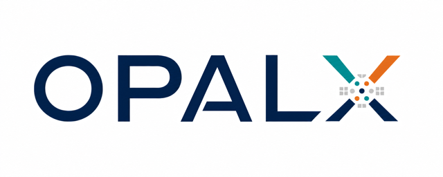
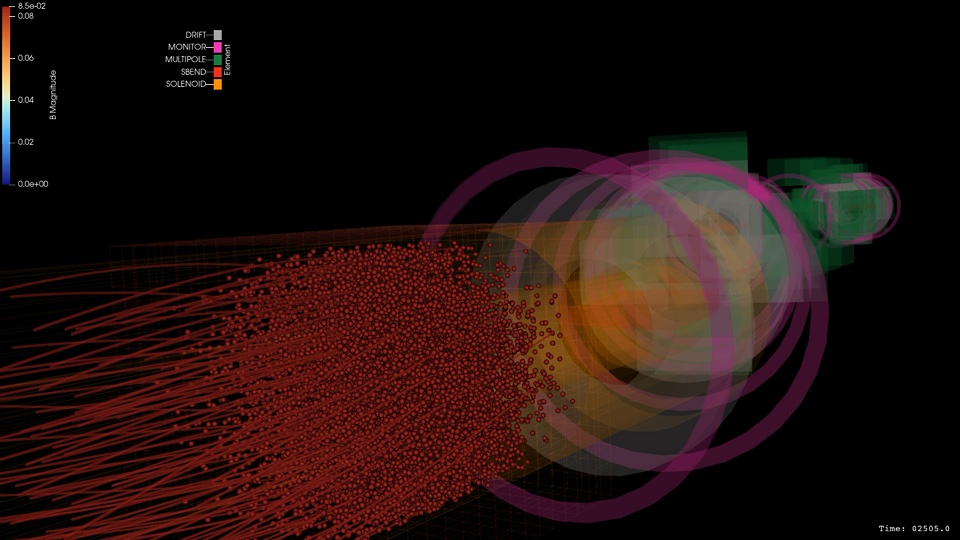

```{=html}
<div class="cover-logo"></div>
```

```{=latex}
\vspace*{-2.5cm}
\begin{flushright}
\includegraphics[width=0.28\textwidth]{opalx-logo.png}
\end{flushright}
\vspace*{0.5cm}
```

```{=html}
<details class="developers" open>
<summary>Main Developers &amp; Institutions</summary>
```

Andreas Adelmann (PSI); Ryan Ammann (PSI/ETH); Yuanjie Bi (Sun Yat-sen University);
John Biddiscombe (CSCS/ETH); Pedro Calvo (CIEMAT); <!-- Achim Gsell (PSI); -->
Carl Jolly (RAL); Severin A. T. Klapproth (PSI/ETH); Alexander Liemen (PSI/ETH);
Sriramkrishnan Muralikrishnan (JSC); <!-- Philippe Piot (NIU); --> Chris Rogers (RAL);
Mohsen Sadr (PSI/MIT); Jochem Snuverink (PSI); Jonathan Thompson (RAL);
Daniel Winklehner (MIT); Michail Zampetakis (PSI)

```{=html}
</details>
<script>
(() => {
  const developers = document.querySelector('.developers');
  const narrow = window.matchMedia('(max-width: 640px)');
  const adapt = () => { developers.open = !narrow.matches; };
  adapt();
  narrow.addEventListener('change', adapt);
})();
</script>
<div class="institution-grid" aria-label="Contributing institutions">
  <div></div>
  <div></div>
  <div></div>
  <div></div>
  <div></div>
  <div></div>
  <!-- <div></div> -->
  <div></div>
  <div></div>
</div>
```

:::::: {.frontpage-updates}
::::: {.frontpage-news}

## News {#news .unnumbered}

```{=html}
<div class="news-ticker" role="region" aria-label="Latest news" aria-roledescription="carousel">
<div class="news-slides">
<article class="news-strip news-slide" aria-labelledby="news-release-title" aria-roledescription="slide" aria-label="1 of 3">
  <div class="news-release-badge" aria-hidden="true"><span>OPALX</span><strong>V 1.0.0</strong></div>
  <div class="news-copy">
    <p class="news-kicker">Release news · <time datetime="2026-11-01">1 November 2026</time></p>
    <h3 id="news-release-title">OPALX 1.0.0 released 1.11.2026</h3>
  </div>
</article>
<article class="news-strip news-slide" aria-labelledby="news-mue4-title" aria-roledescription="slide" aria-label="2 of 3" hidden>
  <button class="news-thumbnail" type="button" aria-label="Play PSI MuE4" aria-haspopup="dialog" data-news-play>
    
    <span class="news-play" aria-hidden="true">▶</span>
  </button>
  <div class="news-copy">
    <p class="news-kicker">Featured movie · <time datetime="2026-10-30">30 October 2026</time></p>
    <h3 id="news-mue4-title">PSI MuE4</h3>
    <p>Watch the PSI MuE4 visualization.</p>
    <button class="news-watch" type="button" data-news-play>Watch movie <span aria-hidden="true">↗</span></button>
  </div>
</article>
<article class="news-strip news-slide" aria-labelledby="news-paper-title" aria-roledescription="slide" aria-label="3 of 3" hidden>
  <div class="news-release-badge" aria-hidden="true"><span>OPALX</span><strong>Paper</strong></div>
  <div class="news-copy">
    <p class="news-kicker">Research news · arXiv:2611.00124</p>
    <h3 id="news-paper-title">The OPALX paper is on arXiv</h3>
    <p>OPALX: A performance-portable framework for particle accelerator simulations</p>
    <a class="news-watch" href="https://arxiv.org/abs/2611.00124">Read the paper <span aria-hidden="true">↗</span></a>
  </div>
</article>
</div>
<div class="news-ticker-controls">
  <button type="button" data-news-prev aria-label="Previous news item">←</button>
  <span data-news-position aria-live="off">1 / 3</span>
  <button type="button" data-news-next aria-label="Next news item">→</button>
  <button type="button" data-news-pause aria-pressed="false">Pause news</button>
</div>
</div>
<dialog id="news-movie" class="news-movie" aria-labelledby="news-movie-title">
  <div class="news-movie-header">
    <h3 id="news-movie-title">PSI MuE4</h3>
    <button type="button" data-news-close aria-label="Close movie">Close ✕</button>
  </div>
  <video controls playsinline preload="none" poster="assets/images/news/2026-10-30-mue4-analytical-trails.jpg" aria-label="PSI MuE4 movie">
    <source data-src="/tutorials/2026/features/2026-10-30-mue4_analytical-trails.mp4" type="video/mp4">
    Your browser does not support embedded video.
  </video>
  <p><a href="/tutorials/2026/features/2026-10-30-mue4_analytical-trails.mp4" download>Download movie (MP4, 121 MB)</a></p>
</dialog>
<script>
(() => {
  const ticker = document.querySelector('.news-ticker');
  const slides = [...ticker.querySelectorAll('.news-slide')];
  const pause = ticker.querySelector('[data-news-pause]');
  const position = ticker.querySelector('[data-news-position]');
  const dialog = document.querySelector('#news-movie');
  let current = 0;
  let paused = false;
  let timer;
  const show = index => {
    current = (index + slides.length) % slides.length;
    slides.forEach((slide, i) => { slide.hidden = i !== current; });
    position.textContent = `${current + 1} / ${slides.length}`;
  };
  const schedule = () => {
    clearInterval(timer);
    pause.textContent = paused ? 'Resume news' : 'Pause news';
    pause.setAttribute('aria-pressed', String(paused));
    if (paused || dialog.open || document.hidden) return;
    timer = setInterval(() => show(current + 1), 3000);
  };
  ticker.querySelector('[data-news-prev]').addEventListener('click', () => { show(current - 1); schedule(); });
  ticker.querySelector('[data-news-next]').addEventListener('click', () => { show(current + 1); schedule(); });
  pause.addEventListener('click', () => { paused = !paused; schedule(); });
  document.addEventListener('visibilitychange', schedule);
  const video = dialog.querySelector('video');
  const source = video.querySelector('source');
  document.querySelectorAll('[data-news-play]').forEach(button => {
    button.addEventListener('click', () => {
      if (!source.hasAttribute('src')) {
        source.src = source.dataset.src;
        video.load();
      }
      dialog.showModal();
      schedule();
    });
  });
  dialog.querySelector('[data-news-close]').addEventListener('click', () => dialog.close());
  dialog.addEventListener('close', () => { video.pause(); schedule(); });
  schedule();
})();
</script>
```

:::::
::::: {.frontpage-history}

## Latest Changes to the Manual {#latest-changes .unnumbered}

::: {#latest-changes-list}
:::

:::::
::::::

:::: {.hero}
# Simulate charged-particle accelerators across CPUs and GPUs {.unnumbered}

OPALX brings high-statistics, three-dimensional beam dynamics to CPUs and GPUs.
Find the user guide, physics models, command reference, and developer handbook
in one searchable manual.

::: {.hero-actions}
[Install OPALX](getting-started/index.qmd)
[Start a simulation](getting-started/first-simulation.qmd){.secondary}
:::
::::

## Find your path

:::: {.doc-grid}
::: {.doc-card}
<span class="eyebrow">Start here</span>

### Getting Started

Build OPALX, choose a platform backend, and run a first input file.

[Get started](getting-started/index.qmd)
:::

::: {.doc-card}
<span class="eyebrow">Run simulations</span>

### User Guide

Learn the input language, beam definitions, runtime options, tracking workflow,
elements, reusable structures, field solvers, and outputs.

[Read the user guide](user-guide/input-language.qmd)
:::

::: {.doc-card}
<span class="eyebrow">Understand the models</span>

### Physics

Follow coordinate conventions, equations of motion, element fields,
collective effects, decay, spin, and photon physics.

[Explore the physics](physics/overview/index.qmd)
:::

::: {.doc-card}
<span class="eyebrow">Look something up</span>

### Reference

See the commands and elements registered by the current executable, build
configuration, file formats, and external API documentation.

[Open the reference](reference/commands.qmd)
:::

::: {.doc-card}
<span class="eyebrow">Contribute</span>

### Developer Guide

Understand the architecture, build and test workflows, and how to add features
without losing GPU portability.

[Read the developer guide](developer-guide/architecture.qmd)
:::

::: {.doc-card}
<span class="eyebrow">Resolve a problem</span>

### Troubleshooting

Diagnose build and runtime failures, prepare reproducible bug reports, and
check known limitations.

[Troubleshoot OPALX](troubleshooting/common-problems.qmd)
:::
::::

::: {.resource-strip}
**Live resources**
[OPALX API documentation]()
[Regression-test dashboard]()
[OPALX source]()
:::

## Acknowledgments and citation

OPALX builds on the original OPAL project and is developed across PSI and its
international accelerator-science partners. Use the
[publications and citation guidance](resources/publications.qmd) when citing
the software. The original OPAL manual remains available as a
[separate historical resource]().
