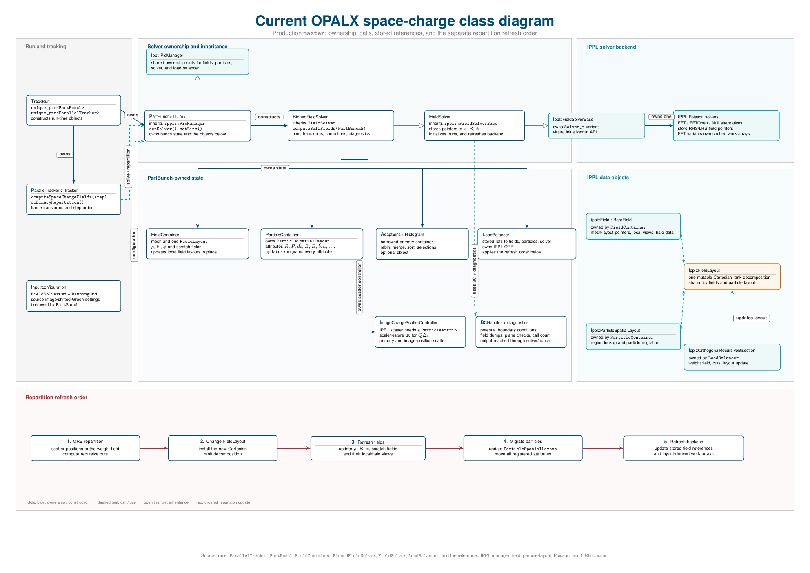

This chapter is the physics-level counterpart to the
[Field Solver user guide](../../user-guide/field-solver/index.qmd). The user
guide documents input choices and current runtime behavior; this chapter will
derive the model, state its approximations, and collect numerical validation.

::: {.callout-note title="Documentation skeleton"}
The headings below define the intended scope. The sections on
[P3M](#physics-p3m), [cathode image fields](#physics-dirichlet-boundaries), and
[binned rest-frame space charge](#physics-binned-space-charge) are written.
The remaining headings contain only short writing prompts so that equations
and claims can be added after they are checked against the implementation and
benchmark cases.
:::

## Scope and notation {#field-solver-scope}

Define the charge, field, coordinate, unit, and sign conventions used throughout
the chapter. State which parts apply to all solvers and which are specific to
space charge.

## Governing electrostatic model {#governing-electrostatic-model}

State the quasi-static approximation and the physical problem solved in the
selected bunch frame.

### Poisson equation {#poisson-equation}

Introduce the source term, potential, electric field, and boundary data.

### Self-field force {#self-field-force}

Connect the solved fields to the force applied by the tracker, including any
frame transformation required before the particle push.

## Particle-mesh discretization {#particle-mesh-discretization}

Describe the complete particle-in-cell cycle and identify the discrete
quantities that live on particles and on the mesh.

### Charge deposition {#charge-deposition}

Specify the particle shape, weighting rule, normalization, and treatment of
ghost cells.

### Mesh solve {#mesh-solve}

Define the discrete Poisson operator or convolution used by each solver family.

### Field reconstruction and interpolation {#field-reconstruction}

Explain how the electric field is reconstructed and interpolated back to
particle positions.

## Frames and relativistic transformations {#frames-transformations}

For binned space charge, OPALX first constructs a beam-aligned frame whose
origin follows the bunch and whose longitudinal axis is parallel to the mean
momentum. Let $Q$ denote its orthogonal rotation. Particle coordinates entering
the binned calculation are

$$
\mathbf r'_i=Q(\mathbf r_i-\mathbf r_0),
\qquad
\mathbf p'_i=Q\mathbf p_i.
$$

Both transformations are required: using $\mathbf r'_i$ with unrotated
$\mathbf p_i$ mixes coordinate systems in bin selection, mean-bin momentum,
and the field transformation. Because $Q$ is orthogonal,
$|\mathbf p'_i|=|\mathbf p_i|$ and
$\gamma_i=\sqrt{1+|\mathbf p_i|^2}$ is unchanged. After gathering, positions,
momenta, and electromagnetic fields are rotated back to the tracking frame.

## Boundary conditions and Green functions {#physics-boundary-conditions}

Define each boundary-value problem independently of its input syntax.

### Periodic boundaries {#physics-periodic-boundaries}

Describe the periodic domain, compatibility conditions, and zero-mode handling.

### Open boundaries {#physics-open-boundaries}

Derive the free-space Green-function convolution and doubled-domain method.

### Dirichlet and image-charge boundaries {#physics-dirichlet-boundaries}

OPALX models a cathode as an infinite, grounded, perfectly conducting plane
$z=z_p$ normal to the beam axis, placed at `R0Z` of the
[emission source](../../user-guide/beam-distributions.qmd#emissionsource).
The bunch lies on one side, $z>z_p$. The method of images [@jackson1999]
replaces the conductor by the mirrored charge

$$
\rho_I(x,y,z)=-\rho(x,y,2z_p-z),
\qquad
\phi_I(x,y,z)=-\phi(x,y,2z_p-z),
$$

so that $\phi+\phi_I=0$ on the plane. The bunch is pushed with
$\mathbf E+\mathbf E_I$ and $\mathbf B+\mathbf B_I$.

#### Moving image {#physics-moving-image}

The image of a charge $q$ at $(x,y,z)$ with velocity $\mathbf v=v\hat{\mathbf z}$
is a charge $-q$ at $(x,y,2z_p-z)$ with velocity $-\mathbf v$. For uniform
motion this pair satisfies the perfect-conductor conditions on the plane
exactly: the tangential $\mathbf E$ and the normal $B_z$ cancel, while the
normal $E_z$ and the tangential $\mathbf B$ double and correspond to the surface
charge and surface current. The image is therefore treated like a bunch with
the same rest-frame solve and the reversed velocity. For bin $b$ (see
[binned rest-frame space charge](#physics-binned-space-charge)), with
rest-frame image field $\mathbf E'_I$,

$$
\mathbf E_I=\gamma_b\mathbf E'_I
 -(\gamma_b-1)(\mathbf E'_I\cdot\hat{\mathbf w}_b)\hat{\mathbf w}_b,
\qquad
\mathbf B_I=-\frac{\gamma_b}{c^2}\,\mathbf v_b\times\mathbf E'_I .
$$

Only the sign of $\mathbf B_I$ differs from the real bunch, because
$\hat{\mathbf w}_b$ enters $\mathbf E$ only quadratically. Without binning,
$\gamma_b=1$ and $\mathbf B_I=0$.

#### Explicit image charges {#physics-explicit-images}

With `ZEROFACE_R0Z`, OPALX deposits $-q$ at $2z_p-z$ for every particle and
solves for $\rho+\rho_I$ (unbinned) or for $\rho_I$ in a separate pass per bin
(binned). The mesh must span the bunch, its mirror, and the gap of twice the
bunch-plane distance between them. OPALX uses $2N_z$ longitudinal mesh points
in this mode, so the resolution matches the solve without images only while
the bunch touches the plane and decreases as the bunch moves away.

#### Shifted Green function {#physics-shifted-green}

The shifted-Green method [@qiang2006_1_opalt] evaluates the image field on the
mesh of the real bunch. Let $z_c$ be the centre of that mesh. The mirror point
then satisfies $2z_p-z=\tilde z-s$ with $\tilde z=2z_c-z$ and
$s=2(z_c-z_p)$, so

$$
\phi_I(x,y,z)=-\phi_s(x,y,2z_c-z),
\qquad
\phi_s(\mathbf r)=\frac{1}{4\pi\varepsilon_0}
 \int\frac{\rho(\mathbf r')\,\mathrm d^3r'}{|\mathbf r-\mathbf s-\mathbf r'|},
\qquad
\mathbf s=s\,\hat{\mathbf z}.
$$

$\phi_s$ is an ordinary Hockney convolution of the real charge with the
translated kernel $G(\mathbf r-\mathbf s)$; the image charges themselves never
appear on the mesh. Reflecting the field about $z_c$ and applying
$\mathbf E_I=-\nabla\phi_I$ gives the component rule, which holds in the same
form for the rest-frame fields of a bin:

$$
\mathbf E'_I(x,y,z)=\bigl(-E'_{s,x},\,-E'_{s,y},\,+E'_{s,z}\bigr)(x,y,2z_c-z).
$$

In the rest frame of bin $b$, longitudinal separations grow by $\gamma_b$, so the
kernel shift is $s=2\gamma_b(z_c-z_p)$, with $z_c$ and $z_p$ in laboratory
coordinates. The result is converted with the image transformation above. With
`TYPE=OPEN`, the shifted kernel follows `GREENSF`; with `TYPE=P3M`, it is the
full Coulomb kernel, regularized as $1/\sqrt{r^2+h_{\min}^2/4}$ for
$r<h_{\min}/2$.

The image and bunch meshes coincide, so the resolution does not degrade as the
bunch moves away from the plane. Each bin still needs one additional Poisson
solve.

#### Images with P3M {#physics-p3m-images}

With `TYPE=P3M`, only the real bunch receives the short-range pair term of
[P3M](#physics-p3m). The image field is resolved on the mesh only:

$$
\mathbf E=\mathbf E_{\mathrm{mesh}}+\mathbf E_{\mathrm{pp}}+\mathbf E_{I,\mathrm{mesh}} .
$$

A particle at distance $d_i$ from the plane is separated from the image of a
particle at $d_j$ by at least $d_i+d_j$. A short-range image term is therefore
missing only for pairs with $d_i+d_j<r_c$, which occur only within $r_c$ of the
plane. Neglecting boundary conditions in the short-range interaction
introduces an error of the order of the mesh discretization error
[@wyssling2021].

#### Validity {#physics-image-validity}

The model assumes a flat, infinite, perfectly conducting plane normal to the
direction of motion. It is quasi-static: retardation is neglected, and the image
responds instantaneously to the bunch. `ZEROFACE_MAXSTEPS` disables the correction when the configured step limit
is reached; zero leaves it active indefinitely. The solver does not test
whether the image field is negligible. Choose a finite limit by checking its
effect on the observables.

## Solver formulations {#solver-formulations}

Relate the mathematical problem to the available numerical backends.

### Periodic FFT solver {#physics-fft-solver}

Document the spectral formulation, differentiation, normalization, and
parallel decomposition.

### Hockney open-boundary solver {#physics-open-solver}

Document domain doubling, kernel sampling, padding, and extraction of the
physical-domain result.

### Particle-particle particle-mesh solver {#physics-p3m}

A mesh solve resolves the field only on scales above the mesh spacing $h$. The
field on particle $i$ separates into a smooth part and a part from
discreteness and short-range correlations,

$$
\mathbf E_i=\langle\mathbf E\rangle(\mathbf r_i)+\delta\mathbf E_i ,
$$

and charge deposition followed by a mesh solve retains only the first term
[@mitchell2015]. The second term causes intrabeam scattering, which in dense,
cold beams raises the energy spread far above the prediction of mesh-only
space-charge models [@prat2022]. P3M [@hockney1988] recovers
$\delta\mathbf E_i$ by splitting the Coulomb kernel at the scale $1/\alpha$:

$$
\frac{1}{r}=
\underbrace{\frac{\operatorname{erf}(\alpha r)}{r}}_{\text{mesh}}
+\underbrace{\frac{\operatorname{erfc}(\alpha r)}{r}}_{\text{particle-particle}},
\qquad
\alpha=\frac{2}{r_c}.
$$

#### Long-range mesh part {#physics-p3m-mesh}

The smooth kernel replaces the Green function of the FFT solvers, and
$\mathbf E_{\mathrm{mesh}}=-\nabla(G_L*\rho)$. For open boundaries, the
[Hockney solver](#physics-open-solver) convolves with

$$
G_L(r)=\frac{1}{4\pi\varepsilon_0}\frac{\operatorname{erf}(\alpha r)}{r},
\qquad
G_L(0)=\frac{1}{4\pi\varepsilon_0}\frac{2\alpha}{\sqrt\pi},
$$

which is finite at the origin and needs no regularization. For periodic
boundaries, the [periodic solver](#physics-fft-solver) multiplies by the Ewald
kernel

$$
\hat G_L(\mathbf k)=\frac{1}{\varepsilon_0}\frac{e^{-k^2/(4\alpha^2)}}{k^2},
\qquad \mathbf k\neq\mathbf 0,
$$

and sets the $\mathbf k=\mathbf 0$ mode to zero, which is equivalent to a uniform
neutralizing background. Deposition and interpolation use the same CIC scheme
as the other solvers.

#### Short-range particle part {#physics-p3m-pp}

The complement is summed directly over all neighbours within the cutoff
radius:

$$
\mathbf E_{\mathrm{pp},i}=\frac{1}{4\pi\varepsilon_0}
\sum_{\substack{j\neq i\\ r_{ij}<r_c}}
q_j\,\frac{\mathbf r_{ij}}{r_{ij}^{3}}\,f(\alpha r_{ij}),
\qquad
f(x)=\operatorname{erfc}(x)+\frac{2x}{\sqrt\pi}e^{-x^{2}},
$$

with $\mathbf r_{ij}=\mathbf r_i-\mathbf r_j$. The mesh carries the remaining
fraction $1-f(\alpha r)$ of each pair force, so
$\mathbf E=\mathbf E_{\mathrm{mesh}}+\mathbf E_{\mathrm{pp}}$ is the full
Coulomb field up to the mesh error and the neglected tail $f(\alpha r)$ for
$r\ge r_c$. Below $r=10^{-9}\,\mathrm m$, the singular Coulomb term is replaced
by a linear force that is continuous at that radius.

With [binning](#physics-binned-space-charge), the mesh part is solved for each
bin in the rest frame of that bin. The pair part instead splits the kernel in
the rest frame of each source particle $j$, which moves with its own normalized
momentum $\mathbf u_j=\gamma_j\boldsymbol\beta_j$. At equal laboratory time,
the rest-frame distance of a pair is

$$
s_{ij}^2=r_{ij}^2+(\mathbf u_j\cdot\mathbf r_{ij})^2 ,
$$

and the short-range part of the field of a uniformly moving charge
[@jackson1999, Sec. 11.10; @becker2009] is

$$
\mathbf E_{\mathrm{pp},i}=\frac{1}{4\pi\varepsilon_0}
\sum_{\substack{j\neq i\\ s_{ij}<r_c}}
q_j\gamma_j\,\frac{\mathbf r_{ij}}{s_{ij}^{3}}\,f(\alpha s_{ij}),
\qquad
\mathbf B_{\mathrm{pp},i}=\sum_{\substack{j\neq i\\ s_{ij}<r_c}}
\frac{\mathbf u_j\times\mathbf E_{\mathrm{pp},ij}}{\gamma_j c},
$$

where $\mathbf E_{\mathrm{pp},ij}$ is the term of source $j$. For sources at
rest, this is the sum above. For a common momentum along $z$, it is the pair
field on the separations $(\Delta x,\Delta y,\gamma\Delta z)$, converted to
the laboratory like the mesh field. Since $s_{ij}\ge r_{ij}$, every pair
within the rest-frame cutoff is also a laboratory pair within $r_c$, and the
neighbour search is unchanged. The pair sum runs once for all bins.

Each source thus enters the short-range part with its own velocity and the
long-range part with the velocity of its bin. The binning error is confined to
the smooth long-range kernel: it is bounded as $r\to0$, continuous at $r_c$,
and vanishes for narrow bins. The long-range kernel carries the fraction
$1-f(\alpha s)$ of a pair force, about $0.08$ at $s=r_c/4$, $0.43$ at
$s=r_c/2$, and $0.95$ at $s=r_c$. The particle velocities therefore govern
the sub-cell interactions, which the mesh cannot resolve, while separations
near $r_c$ already follow the bin velocity. Like the mesh part, the pair term
neglects the acceleration of the source.

The mesh deposits each charge weighted by $\Delta t_j/\Delta t$, while the
pair sum uses the unweighted charge. The two differ only during emission, when
particle time steps differ.

#### Accuracy and parameters {#physics-p3m-parameters}

Two dimensionless numbers control the error [@deserno1998]: $\alpha r_c$ for
the truncation of the pair sum and $\alpha h$ for the mesh error of the
long-range part. OPALX fixes $\alpha r_c=2$, so that the neglected tail is at
most $f(2)\approx4.6\times10^{-2}$ of the Coulomb force at $r=r_c$ and decays
as $e^{-\alpha^2r^2}$ beyond. The free parameter is the split distance in mesh
cells,

$$
\kappa=\frac{r_c}{h_{\max}},
\qquad
\alpha h_{\max}=\frac{2}{\kappa},
$$

set by `RCUT_CELLS` (default $\kappa=2$, so $\alpha h_{\max}=1$) or by a fixed
cutoff `RCUT`. At $\kappa=2$ the mesh error dominates. A larger $\kappa$ moves
more of the interaction into the exact pair sum, at a pair cost that grows as
$\kappa^3$ for a fixed mesh. With `RCUT_CELLS`, $r_c$ follows the moving mesh
at every update.

In the rest frame of bin $b$, the longitudinal spacing is $\gamma_b h_z$ while
$r_c$ is unchanged. A mesh that resolves the split in the laboratory frame can
therefore be too coarse in the rest frame. If $\gamma_b h_z$ does not exceed the
largest laboratory spacing for the most energetic bin, $\alpha h$ keeps its
laboratory value $2/\kappa$.

The pair term models physical Coulomb collisions only when every macroparticle
carries the charge of one physical particle. With heavier macroparticles, the
pair term causes artificial collisional heating, which distorts second-order
moments such as the emittance and the energy spread.

#### Neighbour search and load balance {#physics-p3m-neighbours}

Each MPI rank stores ghost copies of the particles within $r_c$ of its region
and sorts local and ghost particles into search cells at least $r_c$ wide. A
particle visits its own and the 26 adjacent cells, and the fields are
accumulated with atomic updates. This requires $r_c$ to be at most half the
rank extent in every direction. A mesh-tied cutoff is reduced to the largest
value that fits, which raises $\alpha h_{\max}$ above $2/\kappa$; a fixed `RCUT`
that does not fit is an error. For periodic boundaries, particles within $r_c$
of the domain boundary are also copied as periodic image ghosts.

With number density $n$, a particle has about $\tfrac{4\pi}{3}r_c^3n$
neighbours, so the pair work of a rank grows as $\sum n^2$ over its cells
rather than with its particle count. The option
[`LOADBALANCINGPAIRWEIGHT`](../../user-guide/options.qmd) $=\beta$ therefore
weights the ORB partition per mesh vertex by

$$
w=(1-\beta)\frac{n}{\sum n}+\beta\frac{n^2}{\sum n^2},
$$

where $n$ is the deposited particle count of the vertex and the sums run over
all ranks.

### Iterative solvers {#physics-iterative-solvers}

Reserve this subsection for the operator, convergence criterion,
preconditioning, and supported boundary conditions once an iterative backend
is production-ready.

## Binned rest-frame space charge {#physics-binned-space-charge}

### Quasi-static single-frame model {#physics-quasi-static-frame}

If all particles move with nearly the same velocity
$\mathbf v_f=\beta_f c\,\hat{\mathbf w}$, they are approximately at rest in the
co-moving frame. There, $\mathbf B'=\mathbf 0$ and the field follows from
Poisson's equation [@qiang2006_1_opalt]:

$$
\nabla'^2\phi'=-\frac{\rho'}{\varepsilon_0},
\qquad
\mathbf E'=-\nabla'\phi',
\qquad
\rho'=\frac{\rho}{\gamma_f},
\qquad
x'_\parallel=\gamma_f\,x_\parallel,
\quad
\mathbf x'_\perp=\mathbf x_\perp ,
$$

with laboratory coordinates taken at one laboratory time. The inverse Lorentz
transformation gives

$$
\mathbf E=\gamma_f\mathbf E'-(\gamma_f-1)(\mathbf E'\cdot\hat{\mathbf w})\hat{\mathbf w},
\qquad
\mathbf B=\frac{\gamma_f}{c^2}\,\mathbf v_f\times\mathbf E'
=\frac{1}{c^2}\,\mathbf v_f\times\mathbf E ,
$$

that is, $E_\parallel=E'_\parallel$ and $\mathbf E_\perp=\gamma_f\mathbf E'_\perp$.
For a common, uniform velocity this is exact. The model neglects retardation
and radiation from accelerated particles, and the velocity differences between
particles. The latter requires the particles to be nonrelativistic in the common
frame; for a paraxial beam with longitudinal momentum spread $\Delta p_z$ (in
units of $mc$) [@fubiani2006]

$$
\Delta p'_z\simeq\frac{\Delta p_z}{\gamma_f}\ll1 .
$$

During photoemission this fails: the first electrons are already relativistic
when the last ones leave the cathode, and $\Delta p_z/\gamma_f$ is of order one.

The monolithic mode (`BINS=NONE`) solves Poisson's equation in the laboratory
frame, $\gamma_f=1$, and omits $\mathbf B$. For a relativistic bunch it
overestimates the transverse self-force by up to $\gamma^2$, because the
magnetic force that nearly cancels the electric one is missing.

### Centre-of-momentum correction for one OPEN bin {#physics-open-cm-frame}

For each populated bin, let $\mathbf p_i=\mathbf P_i/(mc)$ and define the
equal-particle averages $\bar{\mathbf p}=\langle\mathbf p_i\rangle$ and
$G=\langle\sqrt{1+|\mathbf p_i|^2}\rangle$. For **one configured bin,
`TYPE=OPEN`, and no active image plane**, OPALX uses the instantaneous
centre-of-momentum frame:

$$
\boldsymbol\beta=\frac{\bar{\mathbf p}}{G},\qquad
D=G^2-|\bar{\mathbf p}|^2,\qquad
\Gamma=\frac{G}{\sqrt D}.
$$

Here $G$ is mean particle energy in units $mc^2$, whereas $\Gamma$ is the bulk
Lorentz factor. They coincide for coherent momenta; a warm sample with zero mean
momentum has $\Gamma=1$ even when $G>1$. The weighted total spatial momentum of
the sampled particles vanishes after this boost. The present single-bunch
implementation assumes equal physical macroparticle weights.

The solve axes are aligned with the bunch mean momentum. In those axes,
$x'=x$, $y'=y$, and $z'=\Gamma z$ relative to the moving origin. The backend
mesh uses $h'_z=\Gamma h_z$ and $\Delta V'=\Gamma\Delta V$. Charge normalization
is therefore $\rho'=\rho/\Gamma$: the deposited `dt*Q` is divided by the solve
timestep and the stretched cell volume, exactly once. For particles taking the
full common timestep, $\sum_j\rho'_j\Delta V'_j=Q$; existing partial-step
emission weights are retained. Lengths are in metres and charge density in
C/m$^3$. The OPEN Poisson problem is
$\nabla'^2\phi'=-\rho'/\epsilon_0$, with $\mathbf E'=-\nabla'\phi'$.

The same $\Gamma$ and $\mathbf v=c\boldsymbol\beta$ enter field reconstruction:

$$
\mathbf E=\Gamma\mathbf E'
 -(\Gamma-1)(\mathbf E'\cdot\widehat{\mathbf v})\widehat{\mathbf v},
\qquad
\mathbf B=\frac{\Gamma}{c^2}\mathbf v\times\mathbf E',
$$

with a zero direction vector when $\mathbf v=0$. Electric fields are in V/m and
magnetic fields in tesla. The actual particle velocity, not the bulk velocity,
is used by the pusher. For a comoving test particle the transverse force is
$q\mathbf E'_\perp/\Gamma$. The bin table's `gammaBin` reports this bulk boost
factor; verbose diagnostics retain `meanParticleGamma` separately.

This remains a frozen electrostatic approximation: $\mathbf B'=0$ is assumed,
and simultaneous laboratory samples are treated as one stationary rest-frame
charge shape. Global zero CM momentum does not imply zero local current.
Internal warm motion, retarded fields, and rest-frame time resynchronization
are not added by this correction.

Multi-bin solves, other backends, and solves with active image planes retain
the earlier representative-frame approximation, using $G$ for both the mesh
stretch and field coefficient and $c\bar{\mathbf p}/G$ for velocity. For warm
bins that pair is not a single consistent Lorentz boost. `BINS=NONE` remains
the separate laboratory electrostatic path. The corrected OPEN path requires
mean momentum along solve z and rejects appreciably tilted inputs supplied
directly to the solver. General tilted bins need a directional stretch
$A=I+(\Gamma-1)\mathbf n\mathbf n^T$, not a change of z spacing alone.

::: {.callout-note #ph-35-03-colleague-review}
## PH-35-03 — proposal for colleague review

::: {style="color: #c00000;"}
This proposal is under review. The original text above remains unchanged.

**Proposed replacement: representative frame and centre-of-momentum distinction**

For each populated bin, OPALX computes the equal-particle averages
$\bar{\mathbf p}=\langle\mathbf P_i/(mc)\rangle$ and
$G=\langle\sqrt{1+|\mathbf p_i|^2}\rangle$. The mesh stretch and field
coefficient use $G$, and field reconstruction uses
$\mathbf v=c\bar{\mathbf p}/G$. This also applies to one configured OPEN bin
without an active image plane. The bin diagnostic `gammaBin` reports $G$.

These representative parameters constitute a consistent Lorentz boost only
when $G^2-|\bar{\mathbf p}|^2=1$. For a warm bin, the physical
centre-of-momentum boost would instead have

$$
\boldsymbol\beta_{\mathrm{CM}}=\frac{\bar{\mathbf p}}{G},\qquad
\Gamma_{\mathrm{CM}}=\frac{G}{\sqrt{G^2-|\bar{\mathbf p}|^2}}.
$$

The distinction matters even for zero mean momentum: the physical bulk factor
is then one, whereas the mean particle factor $G$ can exceed one. A separate
centre-of-momentum correction and a `meanParticleGamma` diagnostic are not
implemented in either source revision checked for this audit. `BINS=NONE`
remains the laboratory electrostatic path. Narrow, approximately coherent,
forward-moving bins limit the representative-frame approximation; binning does
not add retardation, radiation, or rest-frame time resynchronization.

**Related proposed edit in the next subsection:** replace the exception for a
single-bin OPEN correction with:

$\gamma_f=\gamma_b$. The [representative frame parameters](#physics-open-cm-frame)
are bin means over the $n_b$ particles of the bin:
:::
:::

### Energy-binned decomposition {#physics-binned-decomposition}

Binning restores the validity condition bin by bin
[@qiang2006_1_opalt; @fubiani2006]. The particles are partitioned into $N_b$ bins
of a binning variable $\zeta(p_z)$. Since $\rho=\sum_b\rho_b$ and the field
equations are linear, the field splits in the same way, and each contribution
is approximated in the rest frame of its bin:

$$
\mathbf E\approx\sum_{b=1}^{N_b}\Bigl[\gamma_b\mathbf E'_b
 -(\gamma_b-1)(\mathbf E'_b\cdot\hat{\mathbf w}_b)\hat{\mathbf w}_b\Bigr],
\qquad
\mathbf B\approx\sum_{b=1}^{N_b}\frac{\gamma_b}{c^2}\,\mathbf v_b\times\mathbf E'_b,
$$

where $\mathbf E'_b$ solves the rest-frame problem for $\rho_b$ with
$\gamma_f=\gamma_b$. Except for the [single-bin OPEN correction](#physics-open-cm-frame), the
representative frame parameters are bin means over the $n_b$ particles of the bin:

$$
\gamma_b=\frac{1}{n_b}\sum_{i\in b}\gamma_i,
\qquad
\mathbf v_b=\frac{c\,\langle\mathbf p\rangle_b}{\gamma_b},
\qquad
\hat{\mathbf w}_b=\frac{\langle\mathbf p\rangle_b}{|\langle\mathbf p\rangle_b|}.
$$

On the mesh, the solve uses the [beam-aligned frame](#frames-transformations).
For each non-empty bin, OPALX deposits only the particles of that bin, divides
the density by $\gamma_b$, stretches the longitudinal spacing to $\gamma_b h_z$,
solves, and converts the mesh field to $\mathbf E_b$ and $\mathbf B_b$. The
contributions are accumulated on the mesh and interpolated to the particles in
one gather. With a [cathode plane](#physics-dirichlet-boundaries), each bin
also has an image solve.

As the bin widths go to zero, the binned field converges to the quasi-static
model for the full velocity distribution, not to a solution of Maxwell's
equations. Retardation, radiation, and the transverse velocity spread inside a
bin remain unresolved. One explicit bin (`MAXBINS=1`) applies the single-frame
model to the whole bunch; `TYPE=OPEN` without an active image plane uses the
centre-of-momentum correction above. With `TYPE=P3M`, only the long-range mesh part is
binned; the [short-range pair part](#physics-p3m-pp) uses the velocity of each
particle.

### Binning variable {#physics-binning-variable}

The bins are rebuilt from the current momenta at every field evaluation, using

$$
\zeta_i=\frac{|p_{z,i}|}{\sqrt{1+p_{z,i}^2}}\quad(\mathtt{VELOCITYZ}),
\qquad
\zeta_i=\sqrt{1+p_{z,i}^2}\quad(\mathtt{GAMMAZ}).
$$

To first order, a bin of width $\Delta\zeta$ has the rest-frame spread

$$
\Delta p'_z\simeq\gamma_b^2\,\Delta\beta_z\simeq\frac{\Delta\gamma_z}{\beta_b\gamma_b}.
$$

A fixed width in $\beta_z$ thus admits a spread growing as $\gamma_b^2$, but the
range of $\beta_z$ shrinks as the bunch becomes relativistic, so the bins merge
by themselves. A fixed width in $\gamma_z$ admits a spread decreasing as
$1/(\beta_b\gamma_b)$.

### Adaptive bin merging {#physics-adaptive-binning}

With `ADAPTIVEBINNING=FALSE`, the range $R=\zeta_{\max}-\zeta_{\min}$ is
divided into $N_{\max}=$ `MAXBINS` uniform bins. Otherwise, these fine bins
are merged into $N_b\le N_{\max}$ contiguous bins that minimize
[@liemen2025]

$$
C=\sum_{b=1}^{N_b}\Bigl[
w_b\,p_b\ln p_b
+\alpha_{\mathrm{bin}}\,w_b^2
+\beta_{\mathrm{bin}}\,(w_b-w_d)^2
+\frac{w_d}{p_b}\,\Theta(w_d-p_b)\Bigr],
$$

where $p_b$ is the fraction of particles in bin $b$, $w_b$ its width in units
of $\zeta$, and $\Theta(x)=1$ for $x>0$, otherwise $0$. The input parameters
are $\alpha_{\mathrm{bin}}=$ `BINNINGALPHA`, $\beta_{\mathrm{bin}}=$
`BINNINGBETA`, and $w_d=$
`DESIREDWIDTH`. The cost is a heuristic for the trade-off between the modeling
error of wide bins, the shot noise of sparse bins, and one Poisson solve per
bin:

- The entropy term favors bins of equal population.
- The width terms set the resolution: $\alpha_{\mathrm{bin}}>0$ favors narrow
  bins, and the deviation term pulls the widths toward $w_d$. For equal
  widths, they balance at
  $N_b\approx (R/w_d)\sqrt{1+\alpha_{\mathrm{bin}}/\beta_{\mathrm{bin}}}$.
- The sparse term acts almost as a lower bound $p_b\gtrsim w_d$, which merges
  sparse tails and bounds $N_b\lesssim1/w_d$.

Because $C$ is a sum over bins, the exact minimum follows from the dynamic
program

$$
D(k)=\min_{0\le i<k}\Bigl[D(i)+c\bigl(p_{ik},(k-i)\,\delta\bigr)\Bigr],
\qquad D(0)=0,
$$

over the first $k$ fine bins of width $\delta=R/N_{\max}$, where $c(p,w)$ is
the summand of $C$ and $p_{ik}$ the particle fraction in fine bins $i+1$ to
$k$. Empty
merged bins are excluded. The merge costs $\mathcal O(N_{\max}^2)$ and does not
depend on the particle number.

A binned step costs approximately

$$
T_{\mathrm{sc}}\approx N_b(1+s)\,T_{\mathrm{solve}}+(1+s)\,T_{\mathrm{dep}}+T_{\mathrm{gather}},
$$

with $s=1$ while a cathode plane is active and $s=0$ otherwise. Each particle
is deposited once per pass, so only the solves grow with $N_b$.

## Emission and conducting boundaries {#physics-emission-boundaries}

Near the cathode, the [conducting plane](#physics-dirichlet-boundaries) and
[binning](#physics-binned-space-charge) act together. Emitted particles start
almost at rest at $z_p$ and are accelerated, so the bunch spans a wide range of
$p_z$. Every bin $b$ has an image bin that moves with $-\mathbf v_b$ and is
solved in the same rest frame, so each bin costs two Poisson solves while the
plane is active. The image field decays with the distance to the plane, and
`ZEROFACE_MAXSTEPS` ends the correction. Like other numerical parameters, this
cutoff requires a convergence check.

The treatment of emission time and of space-charge activation during emission
remains to be documented.

## Numerical accuracy and convergence {#numerical-accuracy-convergence}

Collect the error sources that should be varied in convergence studies.

### Mesh resolution {#mesh-resolution}

Define spatial refinement studies and expected convergence observables.

### Particle noise and deposition order {#particle-noise}

Separate sampling noise from mesh and solver error.

### Time-step coupling {#time-step-coupling}

The particle step is a drift--kick--drift composition. OPALX provides two
self-field sampling conventions while retaining the same Boris kick and
external-field evaluation at the midpoint.

For the default midpoint convention,

$$
\mathbf r_{n+1/2}=D_{\Delta t/2}(\mathbf r_n,\mathbf p_n),\qquad
(\mathbf E_{\mathrm{sc}},\mathbf B_{\mathrm{sc}})_{n+1/2}
 =\mathcal S(\mathbf r_{n+1/2},\mathbf p_n),
$$

followed by the full Boris momentum kick and the second half drift. The
historical pre-step convention instead evaluates

$$
(\mathbf E_{\mathrm{sc}},\mathbf B_{\mathrm{sc}})_n
 =\mathcal S(\mathbf r_n,\mathbf p_n)
$$

before the first half drift. Those gathered fields remain attached to their
particles through that drift and are combined with midpoint external fields.
The input choices are `SCFIELDUPDATE="MIDPOINT"` and `"PRESTEP"`; changing the
choice changes the temporal discretization and therefore requires a new
timestep-convergence study.

## Domain decomposition and load balancing {#domain-decomposition}

Explain which mathematical data are repartitioned and why the field, particle,
and solver state must be refreshed in a defined order.

## Current implementation architecture {#field-solver-architecture}

The following diagram is retained as TikZ source for PDF output. HTML uses a
small generated PNG of the same source so the page does not depend on a
browser-side TikZ renderer.

::: {#fig-current-space-charge-class-diagram}
:::: {.content-visible when-format="html"}
{fig-alt="Current OPALX space-charge class diagram"}
::::

:::: {.content-visible when-format="pdf"}

::::

Current OPALX space-charge class relationships and repartition refresh order.
The editable source is `figures/current-space-charge-class-diagram.tex`.
:::

## Verification and benchmarks {#field-solver-verification}

A one-turn coasting benchmark compared OPALX with OPAL 2022.1 at 72 MeV using
a 2 mA proton bunch, 262144 macroparticles, a $32^3$ open mesh, one momentum
bin, `GREENSF=STANDARD`, and the common timestep
$1.645278052\times10^{-10}$ s. After applying the common-frame momentum
rotation, the endpoint comparison was:

| Observable | OPAL 2022.1 | OPALX | Relative difference |
|---|---:|---:|---:|
| radial RMS size [mm] | 4.608578 | 4.605885 | -0.0584% |
| vertical RMS size [mm] | 4.215521 | 4.217434 | +0.0454% |
| longitudinal RMS size [mm] | 1.980226 | 1.981539 | +0.0663% |
| radial normalized RMS emittance [mm mrad] | 2.793744 | 2.793274 | -0.0168% |
| vertical normalized RMS emittance [mm mrad] | 1.012587 | 1.014261 | +0.1654% |
| longitudinal normalized RMS emittance [mm mrad] | 0.192261 | 0.190979 | -0.6667% |
| RMS energy spread [keV] | 43.354672 | 43.176349 | -0.4113% |

These values establish a cross-code regression point at one discretization;
they are not a mesh, particle-number, or timestep-convergence result. A clean
comparison of the two `SCFIELDUPDATE` conventions with the production field
reconstruction remains to be added.

## Assumptions and known limitations {#field-solver-limitations}

The list covers the models documented above; other solver families remain to
be added.

- All self-fields are quasi-static. Retardation and radiation are neglected,
  also with many bins and with a cathode plane.
- Binning uses the longitudinal momentum only. The transverse velocity spread
  inside a bin is not resolved.
- With binned `P3M`, the long-range part follows the bin velocity, and only the
  short-range pair part follows the velocity of each particle.
- The pair term of `P3M` models physical collisions only for macroparticles
  that carry the charge of one physical particle.
- The cathode is an infinite, flat, perfectly conducting plane normal to the
  beam axis. Only one emission source may define it. Image charges receive no
  `P3M` pair term.
- With periodic `P3M`, IPPL currently creates one ghost per particle near a
  periodic face and shifts it along every periodic axis. The ghost is the
  correct image only for particles near a corner, so short-range pairs across
  a single face or edge are missing.
